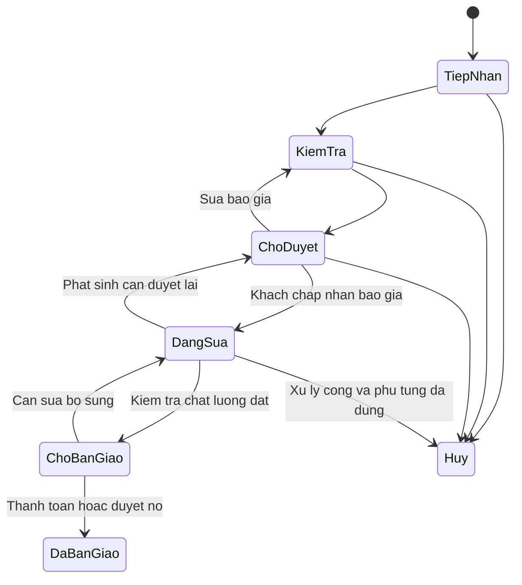

# Quy trình nghiệp vụ đích

Tài liệu này mô tả hành vi cần xây dựng cho vận hành thật, không xác nhận code hiện đã hỗ trợ. Xem `implementation-status.md` để biết hiện trạng. Một cửa hàng; không bán online. Nhân viên có thể được gán quyền bán hàng, sửa chữa hoặc cả hai.

## Quy tắc dùng chung

- Tách trạng thái công việc, trạng thái kho và trạng thái thanh toán.
- Tồn khả dụng = tồn thực tế − lượng đang giữ. Không âm tồn; thay đổi kho phải có chứng từ và người thực hiện.
- Giá bán/giá vốn, mức giảm, thông tin cửa hàng và thông tin khách cần thiết được snapshot lúc chốt chứng từ. Đổi danh mục/cấu hình không viết lại lịch sử. Chứng từ sửa chữa có nhiều phiên bản báo giá.
- Tiền đã thu khác doanh thu. Khoản khách ứng trước khi chưa bàn giao là tiền thu, không tự trở thành doanh thu hoàn thành.
- Đã chốt không xóa lịch sử. Hủy, trả, hoàn hoặc chỉnh kho có lý do, quyền và liên kết chứng từ gốc.
- Ngày lưu theo UTC/timestamptz; ngày hiển thị/báo cáo theo Asia/Ho_Chi_Minh. Đơn bán ghi doanh thu theo thời điểm chốt; sửa chữa theo bàn giao; dòng tiền theo từng thời điểm thu/hoàn. Đây là quy tắc báo cáo vận hành, không thay quy định kế toán/hóa đơn.

## 1. Khởi tạo cửa hàng và tài khoản

Quản lý khai báo tên, điện thoại, địa chỉ và cấu hình mẫu phiếu. Không lấy tên cửa hàng làm tên tài khoản. Khởi tạo quản lý đầu tiên bằng luồng quản trị tin cậy; các lần cấp tài khoản sau chỉ quản lý được thực hiện. Không mở đăng ký công khai cho nhân viên.

Đăng nhập → server xác minh session → đọc profile đang hoạt động → lấy quyền → mở màn hình phù hợp. Tắt tài khoản phải chặn thao tác tiếp theo; hết phiên yêu cầu đăng nhập lại, không mất draft không nhạy cảm đang thao tác nếu có cơ chế lưu phù hợp.

## 2. Khách hàng và xe

Tìm theo điện thoại/biển số → chọn khách/xe cũ hoặc tạo mới → kiểm tra dữ liệu → lưu. Một khách có nhiều xe. Biển số chuẩn hóa để tìm và tránh trùng; thông tin xe có thể chưa đủ khi tiếp nhận. Số km ghi theo lần nhận xe, không ghi đè lịch sử.

Không gộp hai khách chỉ vì cùng tên. Gộp/truyền quyền sở hữu xe là thao tác quản lý có nhật ký. Nhân viên chỉ nhận dữ liệu cần cho nghiệp vụ; thợ xem thông tin cần thiết của phiếu được giao.

## 3. Sửa chữa

| Bước | Actor và dữ liệu | Tác động, điều kiện và lỗi |
| --- | --- | --- |
| Tiếp nhận | Bán hàng/quản lý: khách, xe, km, tình trạng, ảnh, yêu cầu | Tạo phiếu; chưa xuất hàng hoặc ghi doanh thu |
| Kiểm tra | Thợ được giao ghi chẩn đoán/công việc đề xuất | Không tự thay giá hoặc cấp quyền cho mình |
| Báo giá | Người có quyền lập phiên bản gồm công, phụ tùng, giảm giá | Tổng do server tính; lưu nội dung gửi khách |
| Khách duyệt | Nhân viên ghi thời gian, người xác nhận, phương thức | Có thể giữ tồn theo báo giá được duyệt; thiếu tồn phải báo rõ |
| Sửa chữa | Thợ cập nhật công; người có quyền xuất phụ tùng | Xuất dùng và giải phóng lượng giữ tương ứng trong một transaction; phát sinh vượt báo giá cần duyệt lại |
| Hoàn thành | Thợ đánh dấu; người phụ trách xác nhận kiểm tra chất lượng | Còn công việc bắt buộc chưa xong thì từ chối |
| Thu tiền | Bán hàng/quản lý ghi từng lần thu và phương thức | Tổng thu không vượt dư nợ; tiền thừa phải có quy trình riêng, không tự tăng doanh thu |
| Bàn giao | Nhân viên kiểm tra thanh toán, phụ tùng và bảo hành | Còn nợ chỉ bàn giao khi người có quyền chấp thuận, có lý do; ghi delivered_at |

Hủy phiếu: giải phóng giữ chưa xuất; kiểm tra hàng đã xuất có thực sự trả được không; lập nhập trả phù hợp và xử lý tiền đã thu/tiền công. Không tự nhập lại vật tư đã dùng chỉ vì đổi trạng thái. Xe đã bàn giao muốn sửa lại tạo phiếu bảo hành hoặc phiếu mới liên kết phiếu gốc.

## 4. Bán phụ tùng tại quầy

Tạo nháp → chọn hàng → xác minh giá/tồn ở server → chốt và xuất kho → ghi thu hoặc khoản còn nợ → in phiếu.

- Khách lẻ được phép khi thanh toán đủ; bán chịu phải có khách xác định và quyền duyệt nợ.
- Transaction chốt tạo chứng từ, snapshot giá/cost, stock movements và payment nếu có thu. Bất kỳ bước nào thất bại thì rollback toàn bộ.
- Hai người bán món cuối: chỉ một đơn thành công; đơn kia nhận `INSUFFICIENT_STOCK` và tải lại số tồn.
- Hủy nháp không tác động kho. Đơn đã chốt không đưa về nháp; dùng nghiệp vụ trả/hủy có chứng từ điều chỉnh.

## 5. Nhập hàng và nhà cung cấp

Tạo nhà cung cấp/phiếu nháp → nhập hàng và giá → kiểm đếm → người có quyền xác nhận nhận thực tế → tăng tồn/tính giá vốn → ghi khoản đã trả hoặc phải trả.

Lưu số lượng đặt, nhận, đơn vị và giá thực tế nếu cho phép nhận từng phần. Chốt giá vốn bình quân dựa trên giá trị tồn và chi phí phân bổ theo quy tắc rõ ràng; giá vốn mỗi dòng xuất không sửa ngược khi lần nhập sau đổi giá. Trả nhà cung cấp giảm tồn và điều chỉnh phải trả theo chứng từ liên kết.

## 6. Kiểm kê, trả hàng và bảo hành

- Kiểm kê: chụp mốc số dư → ghi số đếm → đối chiếu giao dịch trong thời gian đếm → quản lý duyệt chênh lệch/lý do → tạo adjustment. Không ghi đè trực tiếp số lượng tồn từ form.
- Khách trả: chọn dòng gốc → kiểm tra số còn được trả và thời hạn/chính sách → kiểm tra chất lượng → nhập lại hàng bán được hoặc vào khu lỗi → tính hoàn/giảm nợ → quản lý duyệt. Tổng trả và hoàn không vượt chứng từ gốc sau các lần trước.
- Bảo hành: xác định phiếu/dòng gốc và điều kiện → lập phiếu liên kết → ghi công/vật tư bảo hành riêng → theo dõi chi phí. Không chỉnh phiếu gốc để che chi phí.

## 7. Thu chi, công nợ và báo cáo

Mỗi khoản thu, hoàn hoặc chi có chứng từ gốc/đối tượng, phương thức, thời điểm, người tạo, người duyệt khi cần. Sửa sai bằng điều chỉnh/đảo có liên kết, không xóa lịch sử tiền.

Phải thu = giá trị chứng từ hợp lệ − giảm trừ hợp lệ − thu ròng; phải trả tính từ nhập/hoàn trả/chi tương ứng. Không cho sửa tay một số dư độc lập. Chốt ca/ngày đối chiếu tiền mặt, chuyển khoản và chênh lệch có lý do.

Báo cáo tách: doanh thu chốt, tiền thực thu, khoản nợ, giá vốn và lợi nhuận gộp; chi phí vận hành tách khỏi lợi nhuận gộp. Bản in nội bộ không mặc định là hóa đơn điện tử hợp lệ.

## 8. Thay đổi thông tin cửa hàng

Quản lý mở Cài đặt → sửa draft → kiểm tra → lưu cấu hình có version → các màn hình cập nhật. Tên rỗng/quá dài bị từ chối; nhân viên không có quyền cập nhật. Chứng từ mới dùng snapshot mới, chứng từ đã chốt in lại theo snapshot cũ. Demo hiện chỉ có cấu hình trên trình duyệt và mẫu in hiện tại, chưa có snapshot chứng từ.
